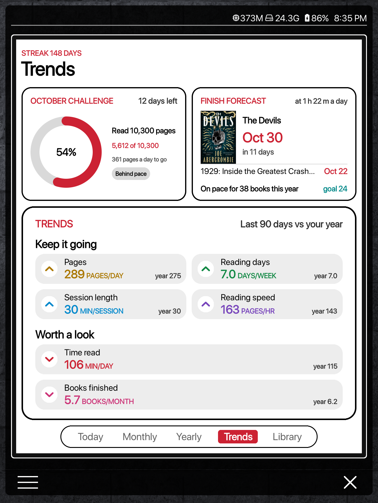
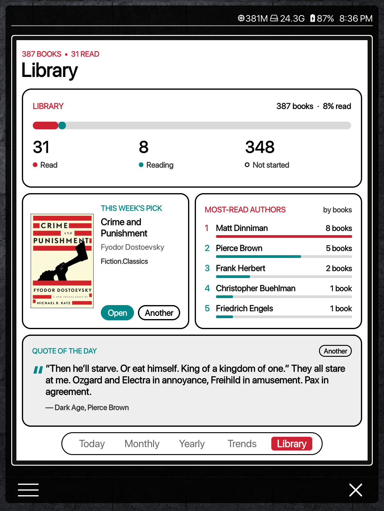
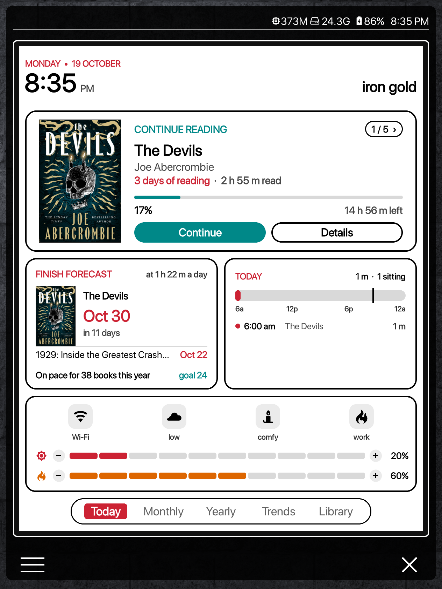
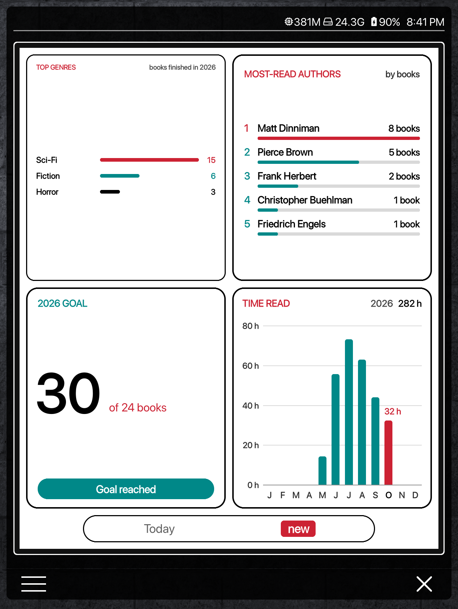
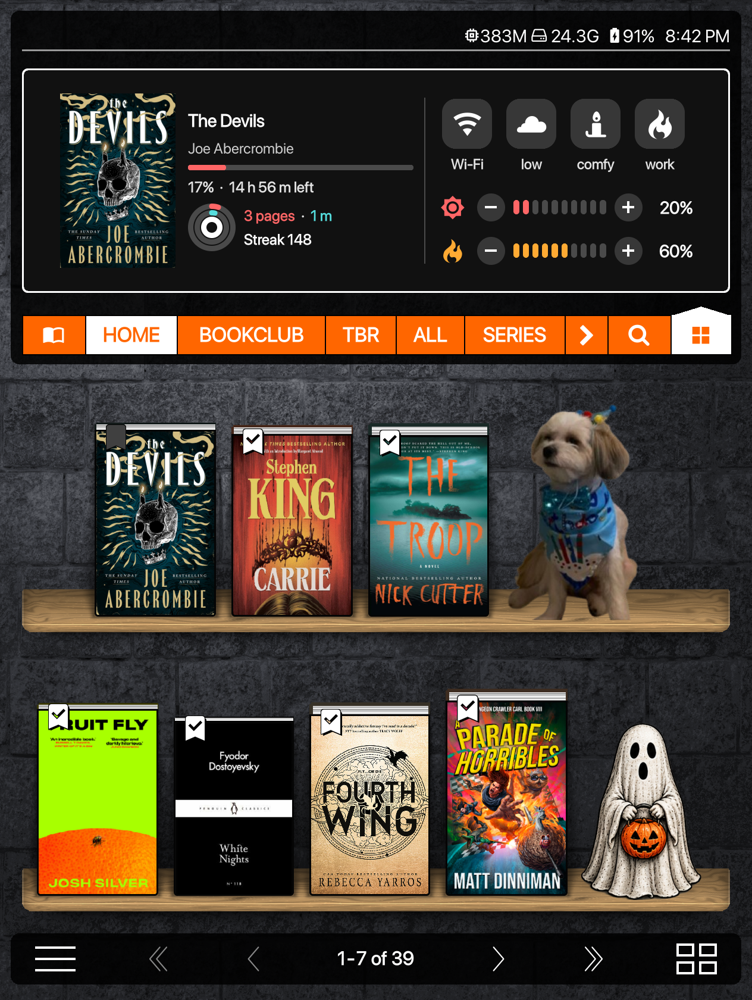

# Reading Log

**A reading dashboard for KOReader's Bookshelf home screen, made for colour e-ink.**

Activity rings, monthly and yearly charts, your longest reads, the time of
day you read, a wall of every cover you finished this year, a book club
tracker, reading trends like Apple's Fitness app, this week against last, a
monthly challenge, library stats, a random pick from your unread books, a
quote from your highlights and a control centre for your light. That's 31
cards for the [Bookshelf](https://github.com/AndyHazz/bookshelf.koplugin)
plugin, plus a Dashboard that puts them together as tabbed pages (Today,
Yearly, Monthly, Trends and Library, and your own), and a Mini dashboard for
the top of the home screen.
Made on, and for, a Kobo Libra Colour.

The ring designs and the idea of a reading dashboard come from
[u/fishnoogz](https://www.reddit.com/user/fishnoogz/)'s Reddit post.

  
  
  

New in 1.1: a Trends page, a Library page, pages of your own, and a Mini
dashboard for the top of the home screen.

  
  
  

  
  

The cards also work one by one, anywhere Bookshelf shows modules: in the
full-screen view or in the home screen's top area. On their own they take on
Bookshelf's look, including its dark theme.

  
  
  
  

## What you need

- [KOReader](https://koreader.rocks) with the
  [Bookshelf](https://github.com/AndyHazz/bookshelf.koplugin) plugin.
- KOReader's **Reading statistics** plugin switched on (it is by default).
  All the reading figures come from it.
- A colour screen is optional. On a black-and-white screen the colours show
  as greys.

## Languages

Reading Log follows KOReader's interface language. English and Italian are
included. Select **Italiano** in KOReader and restart to use the Italian
cards, dashboard and settings. Other languages fall back to English.
Keep the `almanac/locales/` folder when installing or updating.
See [Translating Reading Log](docs/TRANSLATING.md) to add another language.

## Install

1. Download `reading-log-1.1.0.zip` from [Releases](../../releases) and
   unzip it.
2. Connect your e-reader to your computer by USB.
3. On the e-reader, open `.adds/koreader/settings/bookshelf/`.
   - If there is no `micromodules` folder inside `bookshelf`, create one.
   - `.adds` is a hidden folder. In macOS Finder press
     <kbd>Cmd</kbd>+<kbd>Shift</kbd>+<kbd>.</kbd> to show it; in Windows
     Explorer choose View > Show > Hidden items.
4. Open the zip's `micromodules` folder, select **everything inside it** (the
   `alm_*.lua` files and the `almanac` folder) and copy it into
   `.adds/koreader/settings/bookshelf/micromodules/` on the e-reader.
5. Eject the e-reader and restart KOReader.

> [!IMPORTANT]
> Use the `micromodules` folder in KOReader's **settings** folder, as above.
> Do **not** put the files in the Bookshelf plugin's own folder
> (`.adds/koreader/plugins/bookshelf.koplugin/micromodules/`). That folder is
> replaced every time Bookshelf updates, which would delete Reading Log.

Keep the `alm_*.lua` files and the `almanac` folder together: the files are
the cards, and the folder holds the code that draws them.

On other devices the folder is
`/mnt/us/koreader/settings/bookshelf/micromodules/` (Kindle) or
`<koreader folder>/settings/bookshelf/micromodules/` (Android).

**Updating:** copy the new files in the same way and replace the old ones.
Your layout and settings are kept.

## Set up the Dashboard

The Dashboard is the version with the Today, Yearly, Monthly, Trends and
Library tabs. It is meant to fill Bookshelf's full-screen view on its own.

1. Bookshelf menu > Settings > Micro modules: turn on **Full-screen button**.
2. Tap that button, at the bottom right of the Bookshelf home screen, to open
   the full-screen view.
3. Long-press any module there, tap the plus in a circle, and add
   **Reading Log · Dashboard**.
4. Make it the biggest size: long-press the Dashboard and tap **+** until it
   doesn't grow any more.
5. Remove every other module from the view: long-press each one and tap the
   bin. The Dashboard then fills the screen.

Tap the tabs at the bottom to switch pages. The Dashboard's pages can be
changed too: long-press it > Module settings > **Pages and cards**. You can
add pages of your own there (up to seven tabs), and **Put the whole
Dashboard back as it came** in the Dashboard's settings undoes every change.

Optional: for a clean edge round the Dashboard, go to Bookshelf menu >
Settings > Colors and set **Micro-module background** and **Micro-module
border** to white.

To use single cards instead, add any `Reading Log · …` module next to
Bookshelf's own, in the full-screen view or the home screen's top area.

## The Mini dashboard

For the top of the home screen (Bookshelf's top panel): one row of up to
three small cards. As it comes it shows the book you're reading, with a small
row of today's rings under its progress (pages, minutes and streak), then the
Control centre.

1. Bookshelf menu > Settings > Micro modules: turn on **In the top panel**.
2. Long-press a module in the top area, tap the plus in a circle, and add
   **Reading Log · Mini dashboard**.
3. To change its cards: long-press it > Module settings and pick up to three
   (Reading and today's rings, Control centre, Continue reading, Activity
   rings, This week vs last, Week rings, Monthly challenge, Finish forecast,
   Year goal, Today's timeline, Random pick, Quote of the day, Library
   stats). It shows as many as fit, left to right.

## The Dashboard pages

| Page | What's on it |
| --- | --- |
| **Today** | Banner, Continue reading, Activity rings beside Week rings, Book club |
| **Yearly** | Time read by month beside Longest reads (year), Books and pages, Year in covers |
| **Monthly** | Month rings beside Month totals, Pages per day, When you read beside Longest reads (month) |
| **Trends** | Monthly challenge beside Finish forecast, Reading trends |
| **Library** | Library stats, Random pick beside Most-read authors, Quote of the day |

On the Monthly page, the big arrows at the top step back one month at a time
(up to twelve months), and a **Today** button brings you back. Every card on
the page follows.

## What each module does

All the modules are called `Reading Log · …` in Bookshelf's module list.

### Dashboard

**Dashboard** puts the cards below together as tabbed pages (Today, Yearly,
Monthly, Trends, Library) that fill the full-screen view. You can pick the
cards on each page, their order, side by side or full width, and their
height, add pages of your own, change the order of the tabs, and put it all
back as it came.

### Today

| Module | What it does | Tap |
| --- | --- | --- |
| **Banner** | The time and date in big type, plus two lines of your own beside it (empty until you type them). Three styles: Heading, At a glance (with today's pages, reading time and streak) and Classic. | Flashes the screen clean |
| **Continue reading** | The book you're reading: cover, progress, time left, how many days you've been reading it and how much time you've spent on it. Steps through the books you have in progress (3, 5 or 8 of them). | Continue opens the book, Details opens the book menu, `1 / 5 >` shows the next book |
| **Activity rings** | Today's reading as three rings: pages against your daily goal, minutes against your daily goal, and your streak. | Reading progress |
| **Week rings** | A pages ring and a minutes ring for each day this week, with your daily averages for the week. | Reading calendar |
| **This week** | A bar for each day this week, in pages or minutes. | Reading calendar |
| **Year goal** | Books finished this year against your goal, and whether you're on track. Shares its goal with Bookshelf's Reading goals module. | |
| **Book club** | This month's picks from your book club collection with your progress on each, days left in the month, and how much of the club's list you've read. | A book opens it |
| **Today's timeline** | When you read today: each sitting as a block along the day, and a list of them with the time, the book and how long. | Reading calendar |

### Monthly

| Module | What it does | Tap |
| --- | --- | --- |
| **Month rings** | The pages and minutes rings for every day of the month, laid out as a calendar, with your daily averages at the top. | Reading calendar |
| **Month totals** | Books finished, time spent reading and pages read this month, in large type. | The books figure lists the month's books |
| **Pages per day** | A bar for each day of the month (pages or time), with a dashed line at your daily average. | Reading calendar |
| **When you read** | The part of the day you read most in, a bar for each hour, and how your reading splits across morning, afternoon, evening and night. | |
| **Longest reads (month)** | The month's books that took you longest, by reading time or by days, with a bar for each. | A book opens its details |

### Yearly

| Module | What it does | Tap |
| --- | --- | --- |
| **Time read by month** | Hours read in each month this year, as bars, with the year's total. | A month lists the books you finished in it |
| **Longest reads (year)** | The year's books that took you longest, by reading time or by days. | A book opens its details |
| **Books and pages** | Books finished and pages read each month this year, as two lines, with the year's totals. | A month lists its books |
| **Year in covers** | Every cover you finished this year as a wall, in the order you finished them, with the months marked. Shows the newest if they don't all fit. | A cover opens that book's details |
| **Top genres** | The genres you finished most this year. | |
| **Reading heatmap** | A square for each day, more strongly coloured the more you read. | Reading calendar |
| **Recently finished** | The last few books you finished, with the date. | A cover opens the book menu |

### Trends

| Module | What it does | Tap |
| --- | --- | --- |
| **Reading trends** | Like the Trends in Apple's Fitness app: your time read, pages, reading days, session length, reading speed and books finished over the last 90 days, each against your last year, sorted into Keep it going, Worth a look (with a tip) and Needs more data. | Reading progress |
| **Monthly challenge** | One goal for the month as a big ring: pages, minutes or reading days, picked from your last three months (or set by you), with how much each day still needs and whether you're on pace. | Reading calendar |
| **Finish forecast** | When you'll finish the book you're reading at your recent pace ("Oct 24, in 5 days"), the other books you're in the middle of, and how many books your year is on pace for. | A book opens it |
| **This week vs last** | Like Apple Health: "You're averaging more minutes a day this week than last week", with a bar for each week. Time read, pages or both, and this month against last or this year against last instead. | Reading calendar |

### Library

| Module | What it does | Tap |
| --- | --- | --- |
| **Library stats** | How many books you own, have read, are reading, have on hold and haven't started, as figures and one bar. | |
| **Most-read authors** | Your top authors by books finished or by hours read, with a bar for each. | |
| **Random pick** | A book you haven't started, new every day, week or month, or only when you tap Another. Pick from the whole library or one collection, and only the genres or authors you choose. In a series it only offers the next book: six books into eight, it picks the seventh, never the eighth. | Open opens the book, Another picks again |
| **Quote of the day** | One of your own highlights, with the book it came from. The same daily quote as Bookshelf's own Quote of the day. | Opens the book; Another shows a different one |

### Controls

| Module | What it does | Tap |
| --- | --- | --- |
| **Control centre** | One to eight buttons, each with an icon and any action you pick (Wi-Fi, night mode, a plugin, sleep), lit up when they're on, plus brightness and warmth in ten steps. Put it on the Today page or anywhere else. | Each button runs its action; tap a step to set the light |

To put the Control centre (or This week vs last) on a Dashboard page:
long-press the Dashboard > Module settings > **Pages and cards**, pick the
page, tap **+ Add a row**, and pick the card.

### Mini dashboard

| Module | What it does | Tap |
| --- | --- | --- |
| **Mini dashboard** | One row of small cards for the top of the home screen: the book you're reading with today's rings, and the Control centre, as it comes, or up to three you pick. | Each small card does what its big one does |

### Shelves and goals

| Module | What it does | Tap |
| --- | --- | --- |
| **TBR shelf** | A row of covers from one collection (your TBR, say), labelled with your progress or as digital or hardcopy. | A cover opens the book |
| **Finish by** | One book against a date, such as a library loan: days left, pages a day needed, and whether you're on pace. | Opens the book |

## Make it yours

Long-press any card > **Module settings**:

- **The card's own options:** goals, collections, how many books and so on.
- **When tapped:** keep the card's own action, or run anything else instead:
  a plugin, a KOReader action or a menu entry, picked with Bookshelf's action
  chooser. Buttons on a card keep their own job.
- **Card colour:** plain or tinted, and which of the two accent colours leads.
- **Dashboard pages:** add your own pages, rename or hide any page, move the
  tabs, or put the whole Dashboard back as it came.
- **Look and colours** (all cards at once): theme (White, Dark or Paper), two
  accent colours from twelve, how cards look on their own (matching Bookshelf
  or framed in the theme), the day the week starts on, and Diagnostics.

The [guide](docs/GUIDE.md) covers every setting, how the rings and When you
read are worked out, and setting up the book club.

## Credits

- [u/fishnoogz](https://www.reddit.com/user/fishnoogz/) on Reddit, whose post
  inspired the ring designs and the dashboard idea.
- [Bookshelf](https://github.com/AndyHazz/bookshelf.koplugin) by AndyHazz,
  which these cards plug into.
- [KOReader](https://github.com/koreader/koreader) and its Reading
  statistics plugin, where all the numbers come from.

Made by Steven ([@stevenzamora1](https://github.com/stevenzamora1)).

## License

[AGPL-3.0](LICENSE), the same licence as KOReader and Bookshelf.
