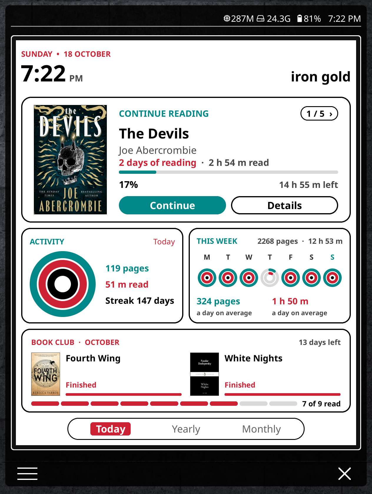
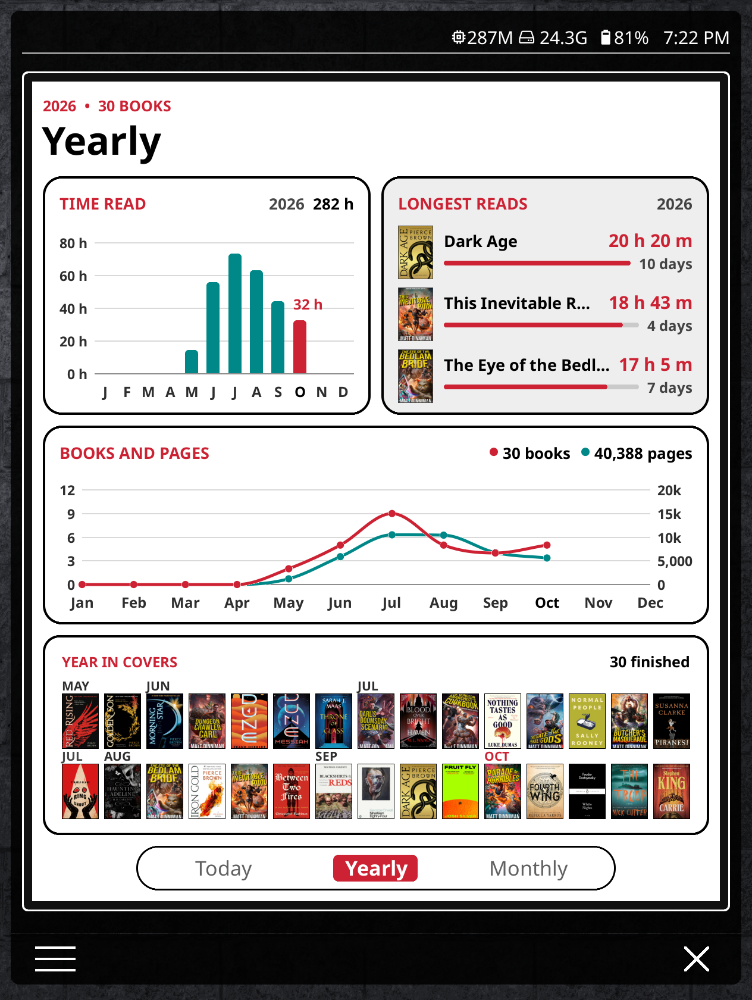
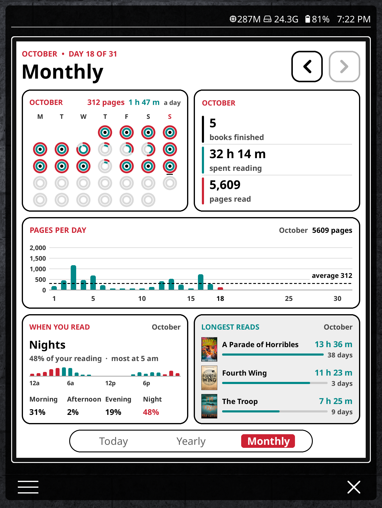
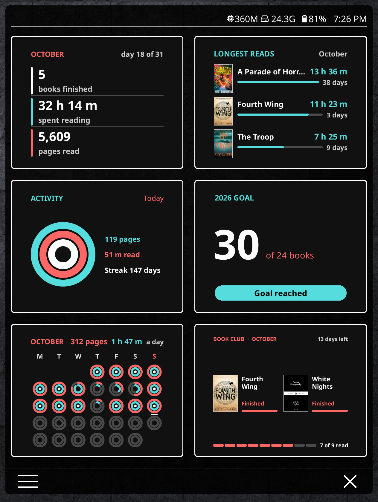
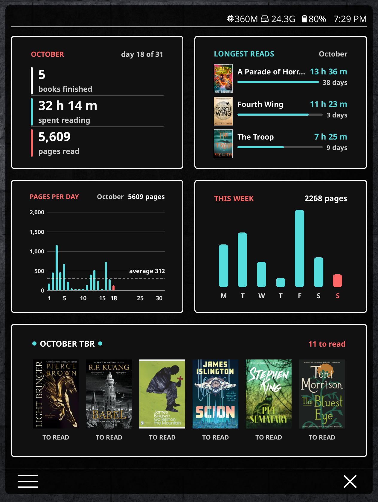
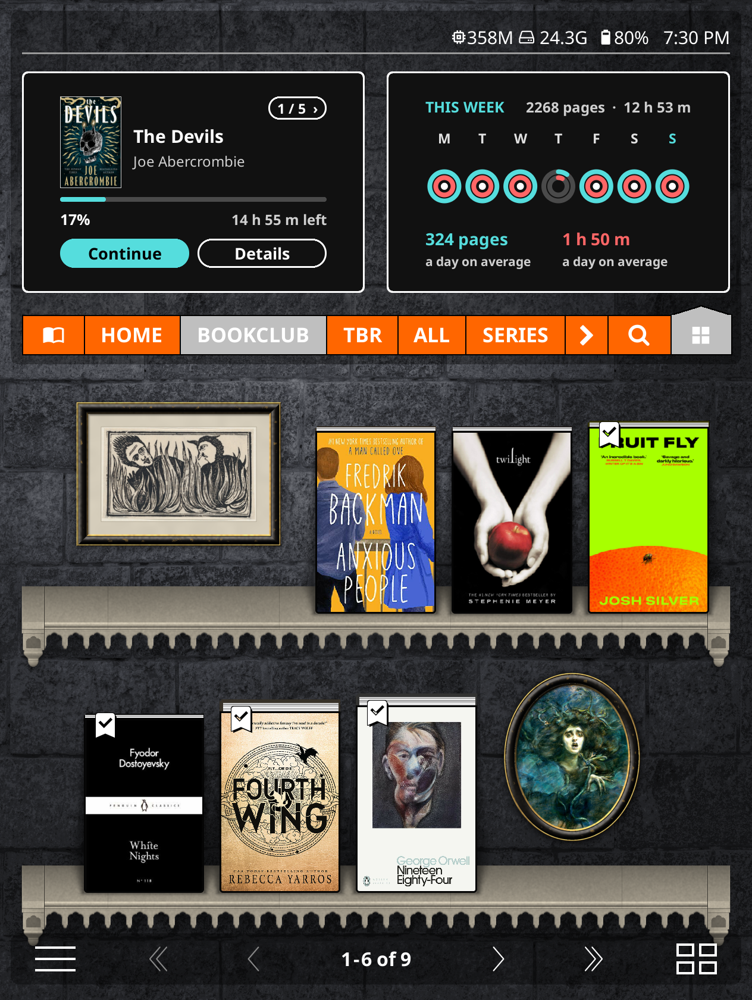
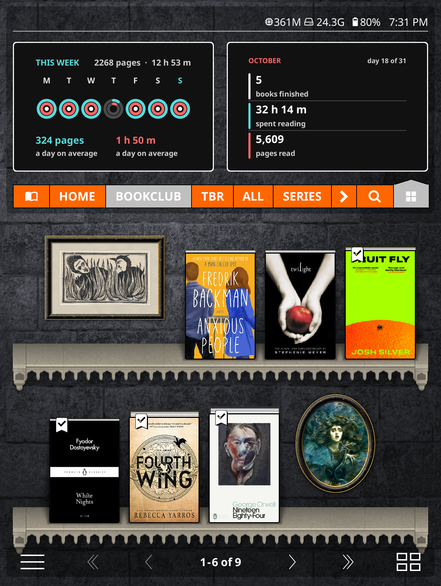

# Reading Log guide

Every card and setting in one place. For the quick version, see the
[README](../README.md).

The ring designs and the idea of a reading dashboard come from
[u/fishnoogz](https://www.reddit.com/user/fishnoogz/)'s Reddit post.

## Install

1. Connect your e-reader by USB and show hidden folders.
2. Open `.adds/koreader/settings/bookshelf/`. If there is no `micromodules`
   folder inside `bookshelf`, create one.
3. Copy **everything inside** the release's `micromodules` folder (the
   `alm_*.lua` files and the `almanac` folder) into
   `.adds/koreader/settings/bookshelf/micromodules/`.
4. Restart KOReader.

Don't use the Bookshelf plugin's own `micromodules` folder
(`.adds/koreader/plugins/bookshelf.koplugin/micromodules/`). It is replaced
whenever Bookshelf updates.

To update, copy the new files over the old ones. Your layout and settings
are kept.

## Set up the Dashboard

1. Bookshelf menu > Settings > Micro modules: turn on **Full-screen button**.
2. Tap that button, at the bottom right of the home screen.
3. Long-press any module, tap the plus in a circle, and add
   **Reading Log · Dashboard**.
4. Long-press the Dashboard and tap **+** until it doesn't grow any more.
5. Long-press every other module and tap the bin to remove it.

## The pages

| Today | Yearly | Monthly |
| --- | --- | --- |
|  |  |  |
| Banner, Continue reading, Activity rings beside Week rings, Book club | Time read by month beside Longest reads (year), Books and pages, Year in covers | Month rings beside Month totals, Pages per day, When you read beside Longest reads (month) |

Tap the tabs at the bottom to switch pages.

**Looking back a month:** on the Monthly page, the left arrow at the top
steps back a month (up to twelve) and the right arrow steps forward. When
you're on another month, a **Today** button appears to bring you back. Every
card on the page follows.

### Editing the Dashboard

Long-press the Dashboard > Module settings > **Pages and cards**.

- Pick a page at the top, then tap a row to change its **Card**, what goes
  **Beside it**, its **Height**, or to move or remove it.
- **+ Add a row** adds one (up to six a page).
- **Tab name**, **Title on the page** and **Page shown / hidden** change the
  page itself.
- **Put this page back as it came** undoes your changes.

## Cards on their own

Any card can also go on its own in Bookshelf's full-screen view or the home
screen's top area: long-press a module, tap the plus in a circle and pick a
`Reading Log · …` card. On their own the cards use Bookshelf's colours,
including its dark theme.

| | | | |
| --- | --- | --- | --- |
|  |  |  |  |

## The cards

Long-press a card > **Module settings** for its options.

| Card | What it shows | Tap | Settings |
| --- | --- | --- | --- |
| Banner | The time and date, and two lines of your own (empty until you type them). Styles: Heading, At a glance (with today's pages, time and streak) and Classic | Flashes the screen clean | Style, top line, bottom line |
| Continue reading | The book you're reading: cover, progress, time left, days of reading and time spent so far | Continue opens the book, Details opens the book menu, `1 / 5 >` shows the next book | How many books to step through |
| Activity rings | Today's pages, minutes and streak as three rings | Reading progress | Daily pages, daily minutes, streak length |
| Week rings | A pages ring and a minutes ring for each day this week, and your daily averages | Reading calendar | Daily pages, daily minutes |
| This week | A bar for each day this week | Reading calendar | Pages or minutes |
| Year goal | Books finished this year against your goal | | Goal, books read outside KOReader |
| Book club | This month's picks, your progress on each, days left, and how much of the club's list you've read | A book opens it | Collection, this month's books, title |
| Month rings | The two rings for every day of the month as a calendar, with your daily averages | Reading calendar | Daily pages, daily minutes |
| Month totals | Books finished, time read and pages read this month | The books figure lists the month's books | |
| Pages per day | A bar for each day of the month, with a line at your daily average | Reading calendar | Pages or time |
| When you read | The part of the day you read most in, a bar for each hour, and the morning, afternoon, evening and night split | | |
| Longest reads (month) | The month's books that took longest, by time or by days | A book opens its details | Longest by, how many |
| Time read by month | Hours read each month this year | A month lists its books | |
| Longest reads (year) | The year's books that took longest, by time or by days | A book opens its details | Longest by, how many |
| Books and pages | Books finished and pages read each month this year, as two lines | A month lists its books | Which pages to count |
| Year in covers | Every cover you finished this year, in order, with the months marked | A cover opens its details | Cover wall or stacked by month |
| Top genres | The genres you finished most this year | | How many |
| Reading heatmap | A square for each day, more strongly coloured the more you read | Reading calendar | |
| Recently finished | The last few books you finished | A cover opens the book menu | How many |
| TBR shelf | A row of covers from one collection | A cover opens the book | Collection, title, line underneath, how many, labels |
| Finish by | One book against a date: days left, pages a day needed, on pace or not | Opens the book | Book, date, label |

### When tapped

Every card's settings have **When tapped**: keep the card's own action, open
the reading calendar or progress view, or run anything else (a plugin, a
KOReader action, a menu entry). Buttons on a card, like Continue and
Details, always keep their own job.

### Book club

1. In KOReader, make a collection with "bookclub" in its name (for example
   `bookclub 2026`) and add the club's books to it.
2. Long-press the card > Module settings > **October's books** (it shows the
   current month) and tick the month's picks. The arrows let you set up
   other months ahead of time.
3. Until you tick anything, the card shows the books from the collection
   you're in the middle of.

### How the rings work

Each ring is a goal. It fills clockwise from the top, and a closed ring means
you met the goal.

- **Activity rings:** outer is pages today against your daily goal, middle is
  minutes today against your daily goal, inner is your streak against 7 days.
- **Week rings** and **Month rings:** a pages ring (outer) and a minutes ring
  (inner) for each day, with a filled centre when you met both goals.

The goals are shared by all three cards; change them in any of their
settings.

### How When you read works

KOReader's Reading statistics plugin records how long you spend on every
page and when. The card adds that time up by the hour of the day, for the
month the Monthly page is showing. Morning is 5 am to noon, afternoon noon
to 5 pm, evening 5 to 9 pm and night 9 pm to 5 am.

## Colours

Long-press any card > Module settings > **Look and colours** (applies to all
cards):

- **Theme:** White, Dark or Paper, for the Dashboard.
- **Accent colour** and **Second accent:** twelve colours chosen to show well
  on colour e-ink.
- **Cards on their own:** match Bookshelf (the default) or framed in the
  theme.
- **Week starts on:** follow KOReader, Monday or Sunday.

Each card's own **Card colour** setting picks plain or tinted, and which of
the two accents leads.

## Remove

Delete the `alm_*.lua` files and the `almanac` folder from
`settings/bookshelf/micromodules/`, then restart KOReader.
